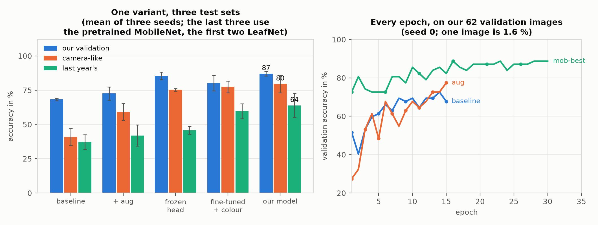
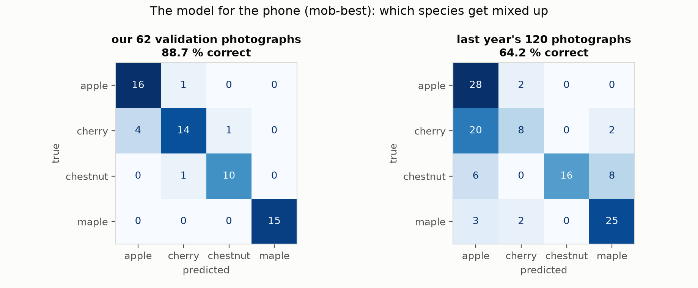

# Task 4 — a better leaf classifier

**What we compared.** Our Task 3 pipeline (`LeafNet` trained with Adam, 15 epochs,
batch 32) is the baseline. Every row below is that baseline with **one** thing
changed, trained on the same 244 photographs with a fixed seed, three seeds for every row
we trained (60 runs). The last rows combine what helped, and two rows add last year's archive.

**How we measured.** Every trained network is measured on three sets, not one:

| set | what it is | one image is worth |
| --- | --- | --- |
| **validation** | our group's 62 photographs that nothing trained on | 1.6 % |
| **camera-like** | the same 62 images once through a random crop, a rotation and a colour change, drawn once with a fixed seed and stored as tensors, so every variant sees exactly the same harder images | 1.6 % |
| **last year's** | the 120 validation photographs of the archive ZIP — other students, other phones, nobody of our group behind the camera | 0.8 % |

The first column is the one we tune against, so we expected it to flatter the networks
more than the other two. The code is the Task 4 cells of the notebook (the same code as
`task4_variants.py`, which writes every run to `task4_results/*.jsonl`).

## The table

Accuracy in %, `mean ± spread over the three seeds` (standard deviation):

| variant | what it changes | training | validation | camera-like | last year's |
| --- | --- | --- | --- | --- | --- |
| `baseline` | Task 3c, nothing added | 244 img, 15 ep | 68.3 ± 0.9 | 40.9 ± 6.1 | 37.2 ± 5.4 |
| `aug` | + geometric augmentation (Task 3d) | 244 img, 15 ep | 72.6 ± 4.8 | 59.1 ± 6.1 | 41.9 ± 7.7 |
| `aug+BN` | + batch normalization (Task 3d) | 244 img, 15 ep | 72.0 ± 4.7 | 55.4 ± 5.7 | 46.7 ± 10.1 |
| `aug+color` | + `ColorJitter` next to the geometric one | 244 img, 15 ep | 70.4 ± 3.4 | 65.1 ± 3.7 | 44.7 ± 4.6 |
| `aug+GAP` | + global average pooling instead of flattening | 244 img, 15 ep | 53.8 ± 10.5 | 46.8 ± 2.8 | 36.9 ± 1.3 |
| `aug+dropout` | + dropout 0.3 before the output layer | 244 img, 15 ep | 69.4 ± 1.6 | 54.8 ± 2.8 | 41.7 ± 8.5 |
| `aug+AdamW` | + AdamW with weight decay 1e-4 | 244 img, 15 ep | 72.0 ± 4.1 | 60.2 ± 7.3 | 40.8 ± 8.5 |
| `aug+smooth` | + label smoothing 0.1 | 244 img, 15 ep | 74.7 ± 3.7 | 60.2 ± 4.9 | 43.1 ± 7.3 |
| `aug+bestep` | + keep the weights of the best epoch | 244 img, 15 ep | 76.9 ± 0.9\* | 59.7 ± 5.8 | 42.2 ± 6.3 |
| `aug+cos40` | + cosine schedule, 40 epochs | 244 img, 40 ep | 74.7 ± 1.9 | 60.8 ± 1.9 | 38.1 ± 3.4 |
| `scratch-best` | BN + dropout + GAP + colour aug + AdamW + smoothing + cosine 40 ep + best epoch | 244 img, 40 ep | 71.0 ± 1.6 | 67.7 ± 0.0 | 48.3 ± 2.9 |
| `task2-onnx` | the model we exported in Task 2, measured as it lies on disk | one model, 15 ep | 77.4 | 74.2 | 64.2 |
| `mob-head` | Task 2 network, **only** the new last layer trained | 244 img, 15 ep | 85.5 ± 2.8 | 75.3 ± 0.9 | 45.8 ± 2.9 |
| `mob-head+aug` | the same frozen backbone, now **with** the augmentation | 244 img, 15 ep | 83.9 ± 3.2 | 71.5 ± 9.7 | 45.8 ± 4.6 |
| `mob-full-plain` | whole network fine-tuned, **no** augmentation | 244 img, 15 ep | 79.0 ± 5.8 | 67.2 ± 3.4 | 54.2 ± 6.3 |
| `mob-full` | Task 2: whole network fine-tuned + augmentation | 244 img, 15 ep | 73.1 ± 1.9 | 76.9 ± 2.5 | 56.4 ± 2.7 |
| `mob-full+color` | fine-tuned + `ColorJitter` | 244 img, 15 ep | 80.1 ± 5.7 | 77.4 ± 4.3 | 59.7 ± 5.4 |
| `mob-full+cos30` | fine-tuned + cosine schedule, 30 epochs | 244 img, 30 ep | 83.3 ± 5.7 | 75.8 ± 4.3 | 57.8 ± 1.3 |
| **`mob-best`** | fine-tuned + colour aug + AdamW + smoothing + cosine 30 ep + best epoch | 244 img, 30 ep | **87.1 ± 1.6** | **79.6 ± 6.5** | **63.9 ± 8.8** |
| `mob-best+hist` | the same, with last year's 700 photographs added | 944 img, 30 ep | 87.6 ± 2.5 | 79.0 ± 4.3 | 88.9 ± 1.0\*\* |
| `scratch+hist` | the best from-scratch net + last year's photographs | 944 img, 40 ep | 73.1 ± 0.9 | 68.8 ± 3.4 | 72.8 ± 0.5\*\* |

\* `aug+bestep` picks the epoch by validation accuracy, so its validation column is
chosen on the images it is scored on and cannot be compared with the others.
\*\* those two rows trained on last year's *training* photographs, so for them the
"last year's" column is no longer an unseen photo session — only their validation and
camera-like columns are fair comparisons with the rows above.

`Leaf_model.` is changed due to task 4 (from task 2). Old model is accesible in commit 1b7981d.

## Is the difference larger than the noise?

The same variant with three seeds moves by more than we would like:

| | seeds (validation, %) | range |
| --- | --- | --- |
| `baseline` | 67.7, 69.4, 67.7 | 1.6 |
| `aug` | 77.4, 67.7, 72.6 | 9.7 |
| `aug+GAP` | 64.5, 53.2, 43.5 | 21.0 |
| `mob-full+color` | 80.6, 85.5, 74.2 | 11.3 |
| `mob-best` | 88.7, 87.1, 85.5 | 3.2 |

On the 62-image sets a single run can therefore swing by ±5 % without anything
changing, and on last year's 120 images `mob-best` gave 64.2 / 72.5 / 55.0 — a 17.5 %
range. Two more facts from the same data:

* **Two runs with the same seed in the same process reproduce to the last digit** (three
  runs of `baseline`, seed 0, all gave validation 0.6774 and training loss 0.279728).
* The same seed with a **different number of compute threads** is a different run:
  `mob-best` with seed 0 gave 88.7 / 75.8 / 64.2 on 3 threads and 90.3 / 85.5 / 69.2 on
  6. The arithmetic order of the parallel reductions changes, 30 epochs amplify it, and
  the best epoch is selected on 62 images.

So the rule we applied when reading the table: **a difference counts only if it is
larger than the spread of both rows** — roughly 5 % on validation, 8–10 % on the two
harder sets. If we rebuilt the table in Colab, expect the same picture with a couple of
points of difference; that difference is this noise, not a mistake.

## What each change brought

**Geometric augmentation — the biggest help for a network trained from scratch.**
40.9 → 59.1 % camera-like and 37.2 → 41.9 % on last year's photographs, while the
*training* loss went the other way (0.26 → 0.63, it can no longer memorise the 244
photographs). The gain on camera-like images (18 %) is larger than the spread of both
rows, so it is real; the 4.7 % on last year's is not.

**Colour augmentation — helps, but we cannot fully trust the set that measures it.**
On the from-scratch net it moved the camera-like set from 59.1 to 65.1 % and last year's
from 41.9 to 44.7 %. The camera-like set is built with the very same `ColorJitter`, so
this row is partly measured on its own training distribution — that is a bias we cannot
remove, and the independent last-year column only gives +2.8 %, inside the noise. On the
pretrained network colour augmentation gives +7.0 % on validation (73.1 ± 1.9 → 80.1 ± 5.7,
so the larger spread of the two rows is ±5.7 and even this is borderline) and +3.3 % on
last year's, which alone would not clear the noise. We keep it in the final model because
light and white balance are exactly what a phone camera changes between sessions, and
because the combination that contains it is the best row of the table.

**The pretrained network is the single largest factor — and Task 2 already used it.**
Every from-scratch row that did not train on the archive stays under 68 % on camera-like
images and under 49 % on last year's; the MobileNet of Task 2 reaches 75 % camera-like with
only its new last layer trained. The exported Task 2 model already sits at 74.2 / 64.2 % on
the two harder sets, above every such row. So transfer learning was not something we had to discover —
244 photographs of four species are simply not enough to learn what a leaf looks like, and
the interesting part of this table is what is left to win *inside* the pretrained family.

**Frozen head, fine-tuned body, augmentation — a 2 × 2, not one comparison.** Four rows of
the table differ only in two things: whether the 927 008 weights of the pretrained body may
move (the 594 948 of the classifier head are trained in every row), and whether the 244
photographs come in plain or augmented. Down a column is unfreezing the
body, to the right is switching augmentation on; every cell is validation / camera-like /
last year's, three seeds each:

| | no augmentation | + geometric augmentation |
| --- | --- | --- |
| **only the new last layer** | 85.5 / 75.3 / 45.8 | 83.9 / 71.5 / 45.8 |
| **whole network fine-tuned** | 79.0 / 67.2 / 54.2 | 73.1 / 76.9 / 56.4 |

Four things fall out of it, and we mark the ones the seed spread does not let us claim:

* **Unfreezing the body helps the photographs of strangers, both times**: +8.4 pp on last
  year's without augmentation (45.8 → 54.2, spreads ±2.9 and ±6.3) and +10.6 pp with it
  (45.8 → 56.4, ±4.6 and ±2.7). Both are larger than the spread of their two rows.
* **Unfreezing costs validation points, both times**: −6.5 and −10.8 pp, the second one
  clearly (±3.2 and ±1.9). The frozen head wins the column we tune on and gives the worst
  cell of this 2 × 2 on the one set that is truly independent — the validation column alone
  would have made us pick the wrong network.
* **Augmentation under a frozen backbone changes nothing we can measure** (85.5 / 75.3 /
  45.8 → 83.9 / 71.5 / 45.8), although it does what it is supposed to do to the training
  loss (0.011 → 0.161: the head can no longer memorise the 244 photographs). The features
  are the same features either way, so the changed pictures only reshuffle what a linear
  head fits on top of them.
* **Augmentation with a trainable body is worth 9.7 pp on the camera-like set** (67.2 →
  76.9, both spreads under 4) and 2.2 pp on last year's, which is inside the noise; it costs
  5.9 pp on validation, which the spread of ±5.8 makes borderline.

So the two changes pay off together and not separately: what wins the two hard columns is a
trainable body *fed* photographs that keep changing. Unfreezing on its own makes the
camera-like set worse (75.3 → 67.2, spreads ±0.9 and ±3.4), and putting the augmentation back
under that frozen body does not win it back (75.3 → 71.5, inside the ±9.7 spread), while the
same one line on a trainable body is worth +9.7 pp (67.2 → 76.9).

**Cosine schedule and more epochs — helps the pretrained network a little, the
from-scratch one not at all.** Fine-tuned: 73.1 → 83.3 % validation but 76.9 → 75.8 %
camera-like and 56.4 → 57.8 % last year's, all within the noise. From scratch: 40 epochs
with cosine did not help on any column (38.1 % last year's, worse than 15 epochs).

**Global average pooling — clearly harmful here.** 68.3 → 53.8 % validation, and the least
stable row of the whole table (±10.5 %, a 21 % range between seeds); its camera-like number
does rise (40.9 → 46.8 %), but not by more than the ±6.1 % spread of the row it came from. It replaces the 2304 numbers our four convolutions leave per image by their 64
channel means, which takes the first linear layer from 147 520 to 4 160 parameters (the
whole network from 208 292 to 64 932) — with 61 training images per species on average
that is too little left to fit, and the run-to-run luck takes over.

**Batch normalization, dropout, AdamW weight decay, label smoothing — nothing measurable
on their own.** Batch normalization is the best of them on last year's photographs
(41.9 → 46.7 %) but moves the other two columns the wrong way by 0.6 and 3.7 %, and its
spread is ±10.1 %. Dropout costs 4.3 % camera-like, AdamW and smoothing move everything by
1–4 % in both directions across seeds. None of them beats the noise alone; we keep them in
the chosen model only as part of the combination, which does look better than plain
fine-tuning (+14 % validation, +2.7 % camera-like, +7.5 % last year's — of which only the
validation part is clearly larger than the spread of the two rows).

**Keeping the weights of the best epoch** did not do what we expected: camera-like and
last year's accuracy stayed where `aug` had them (59.7 / 42.2 vs 59.1 / 41.9). Our
validation accuracy is not noisy enough across epochs for the selection to find anything
(see the right panel of the figure), and its validation column is partly self-chosen.

**Last year's photographs — the result we liked least and believe most.** Adding 700
archive photographs to the training images left the two *fair* columns where they were:
87.1 → 87.6 % validation and 79.6 → 79.0 % camera-like, both differences smaller than one
photograph of the 62 and well inside the seed spread. Its
88.9 % on last year's photographs is not a comparison at all — that model trained on
photographs from the same session as that test set. More data is the one change that
"should" help, and on the measures that are fair to it, it did not: our own 244
photographs plus a good augmentation and a pretrained start already use them up.

**Averaging each image with its mirror** (a leaf mirrored is still the same species, the
"anything else" we tried, no training needed) gave 88.7 → 87.1 % validation,
75.8 → 79.0 % camera-like, 64.2 → 64.2 % last year's. No gain worth twice the computing
in the browser, so it is not in the exported model.

## Which model goes on the phone

Why did the leaf go to the doctor? 

Because it had a bad fall.

**`mob-best`**: the MobileNetV3-small of Task 2, whole network fine-tuned, geometric +
colour augmentation, AdamW with weight decay 1e-4, label smoothing 0.1, cosine schedule
over 30 epochs, weights of the best epoch. Among the rows whose three columns are all fair
comparisons it is the best on **all three** (87.1 / 79.6 / 63.9 %) and one of the most stable
ones (validation spread ±1.6 %). `mob-best+hist` trained on 700 photographs more and came out
level with it on both fair columns (87.6 vs 87.1 % validation, 79.0 vs 79.6 % camera-like —
under one photograph of the 62 either way, next to spreads of ±2.5 and ±4.3) and needs more
than twice the training time (225 s against 92 s per run on our laptop).

What did the tree say to the autumn wind?

Please, just leaf me alone!

Compared with what we exported in Task 2 it costs nothing on the phone: same architecture,
same 96 × 96 input, same mean and std, ONNX file 6.4 MB against 6.3 MB — only the weights
differ. What all the tuning actually bought:

| | our validation | camera-like | last year's |
| --- | --- | --- | --- |
| Task 2 model, as exported | 48 of 62 (77.4 %) | 46 of 62 (74.2 %) | 77 of 120 (64.2 %) |
| `mob-best`, seed 0 | 55 of 62 (88.7 %) | 47 of 62 (75.8 %) | 77 of 120 (64.2 %) |

So: **clearly better on our own session** (+7 photographs of the 62, far beyond the ±1.6 %
seed spread), **a little better on the camera-like set and inside the noise for it**
(+1.6 % on this seed, +5.4 % averaged over three), and **exactly as good on the one truly
independent set** — both models get 77 of the 120 archive photographs right. The honest
reading is that Task 2 had already spent the one big lever (a pretrained network with its
whole body fine-tuned), and the changes we could make from here improve what we tune on
more than they improve what we cannot see. We still choose `mob-best`: it is never worse,
it is the best on two of the three columns, and it costs exactly the same on the phone.

What remains wrong is systematic, not random:

`apple` is where the network sends anything it is unsure of. On last year's photographs it
calls 57 of 120 leaves apple when only 30 are: 20 of the 30 cherry leaves and 6 of the 30
chestnut leaves become apples, and only 8 cherry leaves stay cherry. The Task 2 model makes
the same bias, slightly milder (49 apples predicted, 25 wrong ones sent there, 4 cherries
recognised). A cherry leaf and a young apple leaf are close when the photograph is blurry
and back-lit, which is what a phone camera over a hand in the shade gives — and this is the
same apple/cherry confusion we already wrote down in `REVIEW.md` about the Task 2 page. The
better model does not make *fewer* mistakes on strangers' photographs; it makes the same
mistakes with more confidence, and its extra skill shows up inside our own session. Closing
that gap needs photographs of more sessions — more leaves from more hands and phones — not
another training knob.

**To try it in the course camera app:** 
The task 4 is already deployed directly into the page - 928bf30, URL https://marucmiralova.github.io/mlr-ex08/. `model_info.json` has not changed — it is byte-for-byte identical to `model_info_best.json` (classes apple/cherry/chestnut/maple, input 96, same mean/std), so the preprocessing is the same.

`check_expected.json` was replaced with the new probabilities, otherwise the self-test would expect apple 0.983 against the weights that output apple 0.8534.

The self-test on the page passes after the replacement (verified: apple 0.8534, cherry 0.0973, chestnut 0.0301, maple 0.0192).

The file size is 6,352,615 B compared to the 6,348,541 B of the Task 2 model.

## What we would do next

The honest weak point of this comparison is that the harder camera-like set is only 62
images drawn once, and is built with the same colour jitter we trained with. Both would be
fixed by photographing a fifth session ourselves (a different student, a different day,
another phone) and using it only for testing — then "last year's" would not be the only
truly independent measure. With that, and with the seeds this table already has, the
differences we dismissed as noise could be measured instead of argued about.

## Files

| file | what it is |
| --- | --- |
| `task4_variants.py` | the pipeline and all 20 variants (the Task 4 cells of the notebook, same lines) |
| `task4_table.py` | builds the table above from the run log |
| `task4_final.py` | retrains the chosen model, confusion matrices, mirror test, the ONNX export |
| `task4_results/*.jsonl` | one line per run: seed, three accuracies, training loss, seconds |
| `task4_logs_*.txt` | the per-epoch output of those runs — the right panel of the figure reads it |
| `leaf_model_best.onnx`, `check_expected_best.json`, `model_info_best.json` | the chosen model, ready for the page |
