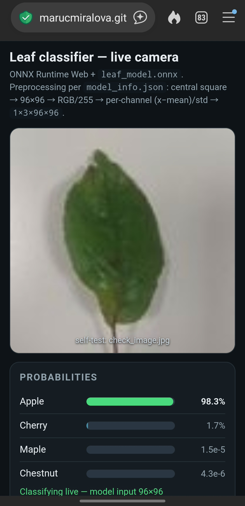
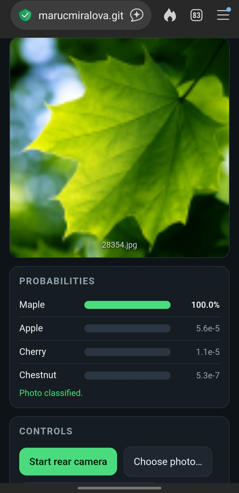
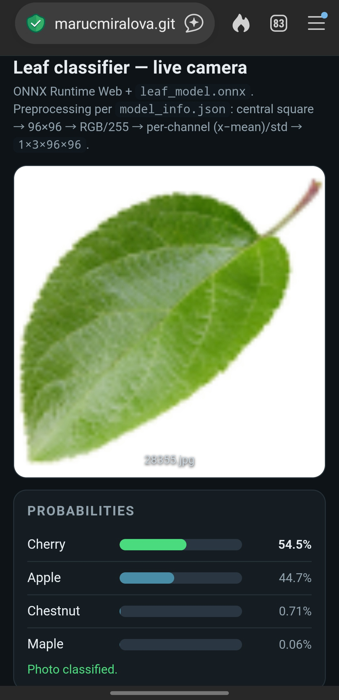

Excercise 08, MLR
\*\* TASK 2 \*\*

1. Q: It runs on your phone: the Pages URL opens on your phone and classifies the live camera. → A screenshot from your phone with a leaf (or a photo of a leaf on another screen) and the probabilities.

| a) self-check | b) Correct detection of maple leaf | c) Mistaken apple leaf |
| :---: | :---: | :---: |
|  |  |  |

Self check is done with 98% of probability of apple leaf (pic. a). It correctly detects maple leaf (pic b)
It does not recognise leaves well - common mistakes are between apple/cherry (pic. c; screenshot is with apple leaf and there is incorrect answer. Others were also mistaken with also mistaken with chestnut). 

2. Q: The same numbers as the notebook: → Upload check\_image.jpg on the page and write its probabilities next to check\_expected.json. Do they agree to three decimals?

They agree on first 4 decimals, the fifth one is different (page gives 0.983354, expected is 0.983353)

3. Q: The preprocessing matches your model: → Find in index.html where the frame is cropped, resized to 96 × 96, divided by 255 and standardized with the mean and std, and in which order the channels go into the tensor. Does it match model\_info.json and the transform of the notebook?

Input sizes matches, mean and std is different (in index it is set to 0,0,0 for mean, 1,1,1 for std; in json it is: "mean": [0.485, 0.456, 0.406], "std": [0.229, 0.224, 0.225]). But the order is the same.

4. Q: Nothing leaves the phone: → Is the image sent anywhere? Which URLs does the page load, and why?

It is not sent anywhere. It only asks for permission to load pictures and the camera; the website also have to have permission to do that. The page is loading only given URL: https://marucmiralova.github.io/mlr-ex08/ it runs locally in the browser.

